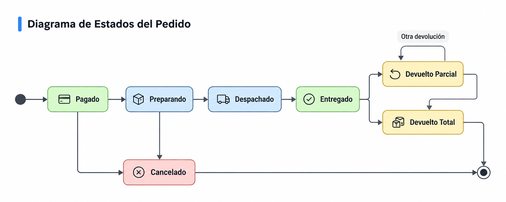

# ShopCart — Tech Challenge 360

Plataforma web de comercio electrónico desarrollada para el **Tech Challenge 360 de Grupo Pentandra**. Incluye **SQL Server**, una **API REST en Node.js + Express + TypeScript** y un **frontend en React + TypeScript**. La solución prioriza integridad transaccional, autorización por roles, trazabilidad, idempotencia y una experiencia de compra utilizable.

> **Estado de entrega (9 de noviembre de 2026).** API, frontend y módulos principales integrados. El catálogo administrativo permite gestionar productos, categorías y variantes, con SKU, atributos, precio y existencia por variante. Las migraciones previstas abarcan `001`–`061`, incluida la corrección de la validación de SKU con guiones. La reproducción desde cero y la regresión completa deben verificarse en un segundo entorno antes de afirmar que la aplicación está certificada para producción.

## 1. Tecnologías

| Capa | Tecnología |
| --- | --- |
| Base de datos | Microsoft SQL Server 2019 o superior, T-SQL, Stored Procedures |
| Backend | Node.js 24, Express 5, TypeScript en modo `strict` |
| Validación y seguridad | Zod, JWT con `jose`, bcryptjs, refresh tokens con rotación, Helmet, CORS, rate limiting |
| Frontend | React 19, TypeScript, Vite, React Router, SweetAlert2, Recharts |
| Imágenes | Subida de archivos JPG/PNG/WebP con validaciones, metadatos en SQL Server y archivos locales |
| Herramientas de desarrollo | Git, npm, SSMS y Postman |

**Arquitectura:**

```text
Navegador / React + TypeScript
            │
            ▼
Express Router → Middleware JWT / rol → Controller → Service → Repository
                                                         │
                                                         ▼
                                         Stored Procedures parametrizados
                                                         │
                                                         ▼
                                                    SQL Server
```

- **Router y middleware:** exposición de rutas, autenticación, roles y límites HTTP.

- **Controller:** validación de entradas, respuestas y errores HTTP.

- **Service:** coordinación de casos de uso.

- **Repository:** invocación de Stored Procedures mediante parámetros tipados de `mssql`.

- **SQL Server:** restricciones de integridad, transacciones, bloqueo concurrente, auditoría y reglas críticas de negocio.

No se utiliza ORM para acceder a los datos de negocio. La API no concatena SQL con valores enviados por usuarios.

## 2. Estructura principal

```text
shopcart-tech-challenge-360/
├── apps/
│   ├── api/
│   │   ├── .env.example
│   │   ├── scripts/generate-demo-hashes.mjs
│   │   ├── src/app.ts
│   │   └── src/modules/
│   │       ├── auth/                 # identidad y sesiones
│   │       ├── catalog/              # productos, variantes, imágenes, precios
│   │       ├── categories/           # categorías
│   │       ├── cart/                 # carrito
│   │       ├── checkout/             # reservas, cotización y compra
│   │       ├── coupons/              # promociones
│   │       ├── inventory/            # existencias y kardex
│   │       ├── orders/               # pedidos, estados y devoluciones
│   │       ├── reports/              # reportes
│   │       ├── audit/                # bitácora
│   │       ├── addresses/            # direcciones
│   │       └── users/                # administración de usuarios
│   └── web/
│       └── src/features/             # pantallas de Cliente, Operador y Admin
├── database/
│   ├── migrations/                   # scripts SQL versionados
│   ├── seeds/                        # datos iniciales y usuarios de prueba
│   └── tests/                        # pruebas SQL
└── docs/diagrams/                    # diagramas entidad-relación y estados
```

## 3. Instalación y ejecución local

### 3.1 Requisitos previos

- Windows con PowerShell (los comandos mostrados usan este entorno); Git y npm.

- **Node.js 24**.

- **SQL Server 2019 o superior** con conexiones TCP/IP y autenticación SQL Server habilitadas.

- **SQL Server Management Studio** o editor que ejecute scripts T-SQL y separadores `GO`.

- Acceso administrativo a SQL Server **solo durante la instalación de migraciones**.

- Puertos disponibles: `3000` (API), `5173` (frontend) y el puerto configurado de SQL Server.

### 3.2 Clonar el repositorio

```powershell
git clone https://github.com/Luis13-L/shopcart-tech-challenge-360.git
cd shopcart-tech-challenge-360
```

### 3.3 Crear la base de datos y permisos

1. En SSMS, conectado con un usuario administrativo, ejecutar `database/migrations/001_CreateDatabase.sql`, que crea `ShopCartDB`.

2. Crear un **login SQL Server** denominado `shopcart_api` con una contraseña robusta local. Establecer `ShopCartDB` como base predeterminada.

3. No conceder a ese login `sysadmin`, `db_owner`, `db_datareader` ni `db_datawriter`. Los scripts de migración otorgan permisos específicos de `EXECUTE`.

4. Ejecutar **todas las migraciones en orden numérico**, desde `002_SecurityTables.sql` hasta `061_FixVariantSkuHyphenValidation.sql` inclusive. No omitir la `059`, `060` ni `061`.

5. Revisar que la migración `011_SystemHealthProcedure.sql` haya creado/vinculado el usuario de base de datos `shopcart_api` y sus primeros permisos.

> Las migraciones se aplican con una cuenta administrativa; **no** se ejecutan con la cuenta limitada de la API. Si una migración da error, detener la secuencia, consultar el mensaje y corregir la causa antes de continuar. No recrear ni borrar tablas con datos para ocultar el problema.

**Migraciones relevantes del catálogo:**

| Número | Finalidad |
| --- | --- |
| `003` | Tablas de productos, variantes, atributos e imágenes |
| `040` | Auditoría de cambios del catálogo |
| `041` | Historial de precios de variantes |
| `045` | Inicialización automática de existencias en cero al crear variantes |
| `051` | Funciones de imágenes de producto |
| `057` | Listado administrativo de productos activos e inactivos |
| `058` | Reactivación de productos con restauración de variantes basada en auditoría |
| `059` | Creación de variantes con atributos |
| `060` | Listado administrativo y cambio de estado de variantes |
| `061` | Corrección de validación de SKU que contienen guiones |

Para revisar el estado:

```sql
USE ShopCartDB;
GO
SELECT Numero, Nombre
FROM dbo.SchemaMigrations
ORDER BY Numero;
GO
```

En una instalación nueva, el listado debe reflejar todas las migraciones hasta la `061`, sin huecos.

### 3.4 Cargar datos semilla

Después de aplicar las migraciones, ejecutar en SSMS:

```text
database/seeds/001_InitialData.sql
```

Este script prepara los roles y una categoría/producto de muestra; **no** crea credenciales de acceso predefinidas. La variante de muestra inicia sin existencia para evitar ventas sin stock.

Para crear las cuentas de demostración, seguir el apartado 4.

### 3.5 Configurar y ejecutar la API

En una terminal PowerShell situada en el repositorio:

```powershell
cd apps/api
npm ci
Copy-Item .env.example .env
```

Completar `apps/api/.env` con los valores **reales de tu instalación**:

```dotenv
NODE_ENV=development
PORT=3000
CORS_ORIGIN=http://localhost:5173
JWT_SECRET=REEMPLAZAR_CON_SECRETO_BASE64URL_DE_32_BYTES
SQL_SERVER=localhost
SQL_PORT=14333
SQL_DATABASE=ShopCartDB
SQL_USER=shopcart_api
SQL_PASSWORD=REEMPLAZAR_CON_PASSWORD_SQL_LOCAL
```

El puerto `14333` es ilustrativo. Utilizar el puerto TCP/IP configurado en la instancia. `JWT_SECRET` debe ser exactamente **32 bytes codificados en base64url (43 caracteres)**; generarlo con:

```powershell
node -e "console.log(require('node:crypto').randomBytes(32).toString('base64url'))"
```

Conservar el valor de forma segura y **no subir `.env`** al repositorio.

Compilar e iniciar:

```powershell
npm run build
npm run dev
```

Verificar en otra terminal o navegador:

```text
http://localhost:3000/api/health
http://localhost:3000/api/health/db
http://localhost:3000/api/catalog/products
```

La conexión de la API a SQL Server usa cifrado; en desarrollo puede confiar en el certificado local mediante la configuración de `apps/api/src/config/database.ts`. Para producción deben configurarse certificados válidos.

### 3.6 Configurar y ejecutar React

En **otra terminal** desde la raíz del repositorio:

```powershell
cd apps/web
npm ci
npm run build
npm run lint
npm run dev
```

Abrir **http://localhost:5173**. El proxy de desarrollo en `apps/web/vite.config.ts` redirige las solicitudes `/api` hacia `http://localhost:3000`.

> Iniciar API y frontend en terminales distintas. `npm run dev` es un entorno de desarrollo, no una configuración de despliegue público. Para producción hacen falta servidor/proxy HTTPS, variables de entorno, certificado TLS y almacenamiento persistente para archivos.

## 4. Usuarios y credenciales de demostración

| Correo de ejemplo | Rol | Acceso principal |
| --- | --- | --- |
| `admin.demo@shopcart.test` | Administrador | Catálogo, variantes, usuarios, cupones, reportes, auditoría |
| `operador.demo@shopcart.test` | Operador | Pedidos e inventario |
| `cliente.demo@shopcart.test` | Cliente | Carrito, checkout, pedidos y direcciones |

**No existen contraseñas universales publicadas.** El evaluador o responsable de la instalación debe crear las contraseñas de prueba de forma local y recibirlas por un canal seguro separado del repositorio.

Para crear los usuarios en una base limpia:

1. Desde `apps/api`, ejecutar `node scripts/generate-demo-hashes.mjs` y proporcionar **tres contraseñas locales distintas**, de al menos 12 caracteres. El script genera hashes bcrypt de costo 12. **La entrada puede visualizarse en la terminal**: usar un entorno seguro.

2. Copiar `database/seeds/002_DemoUsers.sql` a un archivo temporal **fuera del repositorio**.

3. Sustituir en la copia los marcadores `REEMPLAZAR_HASH_ADMIN`, `REEMPLAZAR_HASH_OPERADOR` y `REEMPLAZAR_HASH_CLIENTE` por los tres hashes generados.

4. Ejecutar la copia en SSMS con permisos de instalación y eliminarla después de confirmar la creación.

5. Verificar el inicio de sesión de cada cuenta desde `/login`.

El seed no cambia la contraseña de cuentas ya existentes. Si esos correos ya existen, utilizar las contraseñas creadas previamente o preparar una nueva base de demostración.

## 5. Funcionalidades según RF-01 a RF-09

| RF | Implementación disponible |
| --- | --- |
| **RF-01. Identidad y roles** | Registro de clientes, login, JWT, refresh tokens con rotación, sesiones y permisos de Cliente, Operador y Administrador; administración de usuarios |
| **RF-02. Catálogo** | CRUD funcional de categorías y productos con desactivación lógica; listado público con filtros; administración de productos activos/inactivos; reactivación; variantes con SKU, atributos, precio y existencia individual; administración de estado y cambio de precio con historial |
| **RF-03. Inventario** | Consulta de existencias, reservas y movimientos de kardex; ajustes con motivo y controles de integridad |
| **RF-04. Carrito** | Agregar, actualizar, consultar y eliminar artículos; validación de existencias |
| **RF-05. Promociones** | Administración de cupones porcentuales o fijos con vigencia, mínimos y límites; cupón general o por categoría y cotización previa al checkout |
| **RF-06. Checkout** | Dirección de entrega, reserva temporal, confirmación transaccional, precios/descuentos históricos e idempotencia; **pago simulado** |
| **RF-07. Pedidos** | Historial del cliente, estados de procesamiento, cancelaciones permitidas, devoluciones parciales/totales y reintegro por kardex |
| **RF-08. Reportes** | Panel con gráficas, ventas por periodo, categorías, top de productos y listado administrativo de pedidos |
| **RF-09. Bitácora** | Auditoría de operaciones relevantes, filtros administrativos, valores anteriores/nuevos y protección contra modificación |

El frontend ofrece rutas por rol y estados de carga, vacío y error. Las capacidades anteriores describen lo implementado; **no implican una certificación de carga ni de seguridad productiva**.

### Rutas del frontend

| Rol | Ruta | Vista |
| --- | --- | --- |
| Público | `/`, `/login`, `/registro` | Catálogo, ingreso y registro |
| Cliente | `/carrito`, `/checkout`, `/mis-pedidos` | Compra e historial |
| Operador | `/operacion/pedidos`, `/operacion/inventario` | Pedidos y kardex |
| Administrador | `/administracion/productos` | Productos y variantes |
| Administrador | `/administracion/categorias`, `/administracion/cupones` | Catálogo y promociones |
| Administrador | `/administracion/usuarios` | Gestión de usuarios |
| Administrador | `/administracion/dashboard`, `/administracion/auditoria` | Indicadores y bitácora |

### Endpoints API principales

| Método | Ruta | Acceso |
| --- | --- | --- |
| GET | `/api/catalog/products`, `/api/catalog/categories` | Público |
| POST | `/api/auth/register`, `/api/auth/login`, `/api/auth/refresh` | Según operación |
| GET | `/api/admin/products` | Administrador |
| PATCH | `/api/admin/products/:id/reactivate` | Administrador |
| GET / POST | `/api/admin/variants` | Administrador |
| PATCH | `/api/admin/variants/:id/status` | Administrador |
| PATCH | `/api/catalog/variants/:id/price` | Administrador |
| POST | `/api/cart`, `/api/checkout/reservations`, `/api/checkout/quote`, `/api/checkout/confirm` | Cliente |
| GET | `/api/orders/my`, `/api/orders/my/:id` | Cliente propietario |
| PATCH / POST | `/api/orders/:id/status`, `/api/orders/:id/cancel`, `/api/orders/:id/returns` | Según permisos y estado |
| POST / GET | `/api/inventory/movements`, `/api/inventory/variants/:id` | Operador o Administrador |
| GET | `/api/reports/sales`, `/api/reports/categories`, `/api/reports/top-products` | Administrador |
| GET | `/api/audit`, `/api/admin/users` | Administrador |

Los cuerpos JSON y filtros son validados con Zod; los detalles concretos se encuentran en `apps/api/src/modules/*/*.schema.ts`. Las operaciones sensibles vuelven a comprobar la autorización dentro de SQL Server.

## 6. Decisiones de diseño y reglas de negocio

### 6.1 Concurrencia y existencias

La **existencia disponible** se calcula a partir de la existencia física y las unidades reservadas que no han vencido. Las transacciones de reserva/confirmación y los cambios de inventario utilizan bloqueos y restricciones para evitar sobreventa al competir por la última unidad. Los movimientos de entrada, venta, ajuste o devolución conservan historial de Kardex con motivo, responsable y saldos.

**Trade-off:** los bloqueos protegen la integridad, pero pueden aumentar la espera cuando varias solicitudes modifican la misma variante.

### 6.2 Idempotencia y pagos

Las operaciones críticas de checkout utilizan una clave de idempotencia y comprobaciones de consistencia de solicitud. Los reintentos de una misma operación no deben duplicar pedidos o cobros simulados. Los pedidos congelan sus importes al confirmar para que los cambios posteriores de precio y cupón no alteren compras anteriores.

**Importante:** no se integra una pasarela de pago real, ni se ejecutan cobros o devoluciones bancarias. Estos estados se simulan dentro del sistema.

### 6.3 Variantes, precios y desactivación

Cada variante es una unidad vendible con **SKU único**, precio, atributos opcionales (por ejemplo, color o talla) y existencias propias. Crear una variante inicializa su existencia en `0`: no se generan entradas ficticias de Kardex. Las existencias se modifican a través del módulo de inventario.

Los cambios de precio se registran en un historial separado. Al desactivar un producto se desactivan sus variantes; la reactivación usa la auditoría para restaurar solo las variantes previamente activas, sin reponer arbitrariamente existencias.

La activación de una variante requiere producto y categoría activos. El catálogo público excluye artículos que no cumplan las condiciones de publicación.

### 6.4 Ciclo de pedidos

El modelo conserva transiciones controladas desde pago, preparación y despacho hasta entrega, además de cancelación y devolución. Los criterios concretos están implementados en los procedimientos SQL y documentados en el diagrama:



La cancelación está restringida a estados permitidos; las devoluciones operan por línea y cantidad, sin permitir reintegrar más de lo adquirido. Los descuentos históricos participan en el cálculo del reembolso simulado.

### 6.5 Autorización y seguridad

- Passwords almacenados con bcrypt; jamás se publican contraseñas de usuarios reales.

- Access tokens JWT de corta vida y refresh tokens con rotación.

- Permisos en rutas, controladores y, para operaciones sensibles, Stored Procedures.

- Validación de pertenencia de carritos, pedidos y direcciones al cliente que solicita el recurso.

- Consulta y operaciones SQL exclusivamente mediante Stored Procedures con parámetros tipados.

- Headers de Helmet, CORS configurado y rate limiting en autenticación.

- Variables de entorno locales no versionadas.

- Auditoría de operaciones con registro de valores anteriores y nuevos, protegida contra alteración.

### 6.6 Confirmaciones y notificaciones con SweetAlert2

Se incorporó **SweetAlert2** en React para presentar confirmaciones antes de operaciones administrativas y comunicar sus resultados de forma clara y consistente. Se utiliza, por ejemplo, al crear o modificar productos, cambiar precios y activar o desactivar productos y variantes.

**Implementación:** las funciones reutilizables `confirmAction`, `showSuccess` y `showError` se centralizan en `apps/web/src/lib/alerts.ts`. Los componentes solicitan confirmación **antes de invocar la API**; si el usuario cancela, no se envía la operación. Tras recibir la respuesta, se muestra un mensaje de éxito o un error comprensible. Esto evita duplicar configuraciones de alertas y estilos en cada pantalla.

**Justificación técnica:**

- **Prevención de acciones accidentales:** una confirmación explícita reduce errores al modificar precios o desactivar recursos.
- **Experiencia uniforme:** diálogos y mensajes consistentes facilitan el uso de los paneles administrativos.
- **Mantenibilidad:** la configuración de botones, tonos y textos comunes se concentra en un módulo compartido, en lugar de repetirse en distintos componentes.
- **Retroalimentación clara:** el usuario distingue entre una acción cancelada, una operación confirmada y una solicitud que falló.

**Trade-off y alcance:** SweetAlert2 agrega una dependencia al frontend y los diálogos modales pueden interrumpir el flujo; por ello se priorizan en acciones con impacto y no en cada interacción. **No constituye un control de seguridad ni reemplaza** las validaciones de Zod, la autorización por roles, las transacciones, la idempotencia o las reglas de los Stored Procedures. La decisión final de aceptar o rechazar una operación sigue estando en el backend y en SQL Server.

## 7. Imágenes de productos

La aplicación admite carga inicial de imágenes de producto y muestra miniaturas en el catálogo y la administración. SQL Server guarda los metadatos y la API sirve los archivos mediante `/api/images/products`.

**Decisión para la entrega:** el reemplazo de imágenes con eliminación automática del archivo anterior **no está implementado**; es una mejora futura. No eliminar archivos manualmente si pueden tener referencias en la base de datos.

Los archivos cargados en `apps/api/uploads/products/` se almacenan localmente. El repositorio conserva la estructura de la carpeta, pero **no garantiza incluir los archivos subidos durante las pruebas**. En un entorno limpio es posible que deban volver a cargarse imágenes para que aparezcan las miniaturas. En producción sería preferible almacenamiento persistente externo y copias de seguridad.

## 8. Verificación y pruebas

**Compilación de la API:**

```powershell
cd apps/api
npm run build
```

**Compilación y análisis del frontend:**

```powershell
cd apps/web
npm run build
npm run lint
```

**Pruebas SQL:** los archivos de `database/tests/` contienen casos de integridad, concurrencia, movimientos de inventario, reservas, checkout, devoluciones, cupones y auditoría. Ejecutarlos solo en una **base de desarrollo**, siguiendo las precondiciones de cada script; algunos requieren múltiples sesiones de SSMS.

**Pruebas manuales realizadas durante el desarrollo:** endpoints de autenticación, catálogo, cupones, cotización, carrito, checkout, usuarios, auditoría y variantes en Postman; pruebas de reintento y aislamiento; validaciones funcionales en el frontend. Se validó específicamente la creación de variantes, el listado con y sin atributos, su estado y las operaciones del panel administrativo.

**Evidencia y límite:** estas verificaciones son manuales y basadas en el entorno de desarrollo. No se declara una suite CI completa, ni una reproducción limpia en otra máquina, ni pruebas de carga integrales superadas.

## 9. Diagramas

- [Modelo entidad-relación general](docs/diagrams/ShopCart_ER_General.png)

- [Seguridad y usuarios](docs/diagrams/ShopCart_ER_Seguridad.png)

- [Catálogo e inventario](docs/diagrams/ShopCart_ER_CatalogoInventario.png)

- [Carrito y checkout](docs/diagrams/ShopCart_ER_CarritoCheckout.png)

- [Pedidos y promociones](docs/diagrams/ShopCart_ER_PedidosPromociones.png)

- [Ciclo del pedido](docs/diagrams/ShopCart_Ciclo_pedido.png)

> Los diagramas documentan el modelo principal; las migraciones posteriores incorporan operaciones adicionales. Si un diagrama no refleja una modificación reciente, prevalece el esquema reproducido por los scripts versionados.

## 10. Limitaciones conocidas y mejoras posteriores

- **Pagos:** pasarela y devoluciones monetarias reales no integradas; el flujo es simulado.

- **Carrito de invitado:** el flujo actual de API prioriza al cliente autenticado.

- **Imágenes:** los archivos subidos localmente requieren persistencia/copia de seguridad externa para un despliegue productivo; reemplazo y limpieza automática de archivos quedan pendientes.

- **Variantes:** creación con atributos, consulta, cambio de estado y precio disponibles; edición posterior de SKU o de atributos de variantes existentes no forma parte del alcance implementado.

- **Instalación:** validada principalmente en el ambiente de desarrollo; falta ensayo independiente en un equipo limpio.

- **Calidad:** ampliar automatización de pruebas, CI, medición de rendimiento y pruebas de concurrencia/carga en entorno reproducible.

- **Despliegue:** HTTPS, secretos, respaldos, almacenamiento persistente y monitoreo deben configurarse según la infraestructura de producción.

**Alcance del proyecto:** aplicación de demostración y evaluación técnica. Una entrega funcional no debe interpretarse como certificación para procesar pagos reales o datos sensibles de producción.
