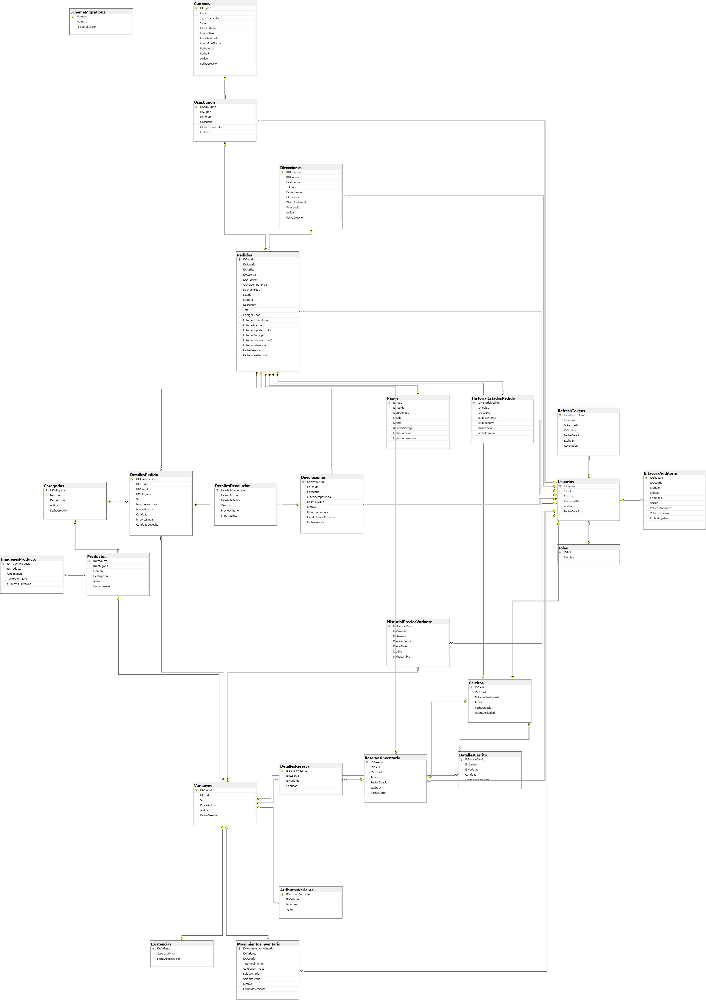

# ShopCart — Tech Challenge 360

Plataforma de comercio electrónico desarrollada para el **Tech Challenge 360**, con una API en Node.js, Express y TypeScript y una base de datos Microsoft SQL Server. El proyecto prioriza integridad transaccional, control de acceso por roles, trazabilidad e idempotencia en operaciones críticas.

> **Estado:** Fase 1 — base de datos y backend implementados, con pruebas funcionales y scripts SQL. Fase 2 — interfaz React e integración pendiente. Véanse las [limitaciones conocidas](#limitaciones-conocidas).

## Tecnologías

| Componente | Tecnologías |
|---|---|
| Backend | Node.js 24, Express, TypeScript |
| Base de datos | Microsoft SQL Server 2019 o superior |
| Validaciones | Zod |
| Autenticación | bcryptjs, JWT y refresh tokens con rotación |
| Seguridad HTTP | Helmet, CORS, limitación de solicitudes y control por roles |
| Herramientas | npm, Git, SQL Server Management Studio (SSMS), Postman |
| Frontend previsto | React y TypeScript (Fase 2) |

## Arquitectura

La API utiliza una **arquitectura por capas**, con separación de responsabilidades:

```text
HTTP → Router → Controller → Service → Repository → Stored Procedure → SQL Server
```

- **Router:** define los endpoints y aplica los middlewares de autenticación y autorización.
- **Controller:** valida y procesa solicitudes HTTP y construye las respuestas.
- **Service:** coordina los casos de uso y las reglas de aplicación.
- **Repository:** ejecuta procedimientos almacenados con parámetros tipados.
- **SQL Server:** implementa restricciones, transacciones, concurrencia y persistencia.

El backend **no utiliza ORM ni SQL embebido para las operaciones de negocio**: el acceso a los datos se realiza mediante *Stored Procedures*, de acuerdo con lo solcitado.

## Requisitos previos

- Node.js **24** y npm.
- SQL Server **2019 o superior**, con autenticación de SQL Server habilitada.
- SQL Server Management Studio (SSMS), o una herramienta equivalente que permita ejecutar scripts T-SQL con separadores `GO`.
- Git para obtener el código fuente.
- Acceso administrativo a la instancia de SQL Server **solo para la instalación**.

> El proyecto utiliza como nombre de base de datos `ShopCartDB`. La API corre de manera predeterminada en el puerto `3000`. El puerto de SQL Server depende de la instalación: `14333` en `.env.example` es únicamente un valor de ejemplo.

## Instalación desde cero

### 1. Obtener el repositorio

```powershell
git clone https://github.com/Luis13-L/shopcart-tech-challenge-360.git
cd shopcart-tech-challenge-360
```

### 2. Crear la base de datos

Conectarse a SQL Server desde SSMS con una cuenta administradora y ejecutar:

```text
database/migrations/001_CreateDatabase.sql
```

Este script crea `ShopCartDB` si no existe.

### 3. Crear el login dedicado de la API

En SSMS: **Security → Logins → New Login**.

1. Nombre: `shopcart_api`.
2. Autenticación: **SQL Server Authentication**.
3. Establecer una contraseña local robusta.
4. Base de datos predeterminada: `ShopCartDB`.
5. Conservar únicamente los permisos de servidor habituales del rol `public`.

No conceder `sysadmin`, `db_owner`, `db_datareader` ni `db_datawriter` a la identidad de la API. La contraseña se utilizará en `apps/api/.env` y **no debe publicarse**.

> Si ya existe el login `shopcart_api` en una instalación funcional, no es necesario crearlo nuevamente ni modificarlo.

### 4. Aplicar las migraciones SQL

Desde SSMS, con la cuenta administrativa, ejecutar los archivos de `database/migrations/` **uno a uno y en orden numérico**, desde:

```text
002_SecurityTables.sql
...
045_FixVariantInventoryInitialization.sql
```

La migración `011_SystemHealthProcedure.sql` vincula el login `shopcart_api` con el usuario dentro de `ShopCartDB` si todavía no existe. Esta migración y las posteriores otorgan permisos `EXECUTE` específicos sobre los procedimientos que utiliza la API.

No ejecutar migraciones administrativas con el usuario `shopcart_api`.

### 5. Cargar los datos iniciales

Ejecutar en SSMS:

```text
database/seeds/001_InitialData.sql
```

Este script inicializa los roles `Cliente`, `Operador` y `Administrador`, junto con una categoría y un producto de ejemplo. **No crea cuentas administrativas ni contraseñas por defecto.**

### 6. Configurar e iniciar el backend

En PowerShell:

```powershell
cd apps/api
npm ci
Copy-Item .env.example .env
```

Editar el archivo **local** `apps/api/.env` con los valores de la instancia:

```dotenv
NODE_ENV=development
PORT=3000
CORS_ORIGIN=http://localhost:5173
JWT_SECRET=REEMPLAZAR_CON_UN_SECRETO_ALEATORIO
SQL_SERVER=localhost
SQL_PORT=14333
SQL_DATABASE=ShopCartDB
SQL_USER=shopcart_api
SQL_PASSWORD=REEMPLAZAR_CON_PASSWORD_LOCAL
```

Generar un secreto para `JWT_SECRET` mediante Node.js:

```powershell
node -e "console.log(require('node:crypto').randomBytes(48).toString('base64url'))"
```

Sustituir los marcadores y configurar `SQL_PORT` según el puerto TCP real de SQL Server. **No copiar este ejemplo con los valores de reemplazo sin completar.**

Compilar e iniciar:

```powershell
npm run build
npm run dev
```

### 7. Verificar la instalación

Con la API en ejecución, comprobar en un navegador o Postman:

```text
GET http://localhost:3000/api/health
GET http://localhost:3000/api/health/db
GET http://localhost:3000/api/catalog/products
GET http://localhost:3000/api/catalog/categories
```

El endpoint `/api/health/db` debe confirmar la conexión a SQL Server.

## Usuarios de demostración

Las siguientes cuentas están destinadas **exclusivamente a un entorno de desarrollo o evaluación**:

| Correo | Rol |
|---|---|
| `admin.demo@shopcart.test` | Administrador |
| `operador.demo@shopcart.test` | Operador |
| `cliente.demo@shopcart.test` | Cliente |

**Las contraseñas no están incluidas en el repositorio.** Cada persona que instale el proyecto deberá elegir contraseñas locales diferentes y generar sus hashes bcrypt.

### Preparación de cuentas

Después de las migraciones y de `001_InitialData.sql`:

1. Abrir una terminal en `apps/api` y ejecutar `npm ci` si todavía no se ha hecho.
2. Ejecutar `node scripts/generate-demo-hashes.mjs`.
3. Elegir tres contraseñas distintas de al menos 12 caracteres, no utilizadas en cuentas reales. El generador produce hashes bcrypt con costo 12; **la entrada puede visualizarse en la terminal**.
4. Copiar `database/seeds/002_DemoUsers.sql` a un archivo temporal **fuera del repositorio**.
5. En la copia temporal, reemplazar `REEMPLAZAR_HASH_ADMIN`, `REEMPLAZAR_HASH_OPERADOR` y `REEMPLAZAR_HASH_CLIENTE` por los hashes correspondientes.
6. Ejecutar esa copia en SSMS con una cuenta administrativa.
7. Eliminar la copia temporal cuando ya no se necesite.

El script crea únicamente las cuentas que no existan y no reemplaza las contraseñas de cuentas preexistentes. Si una cuenta ya existe con un rol diferente, el script rechaza la operación.

### Validar el inicio de sesión

```http
POST http://localhost:3000/api/auth/login
Content-Type: application/json
```

```json
{
  "correo": "admin.demo@shopcart.test",
  "password": "CONTRASENA_ELEGIDA_LOCALMENTE"
}
```

Se espera una respuesta `200 OK` con `accessToken`, `tokenType`, `expiresIn` y los datos del usuario. Repetir la prueba con las cuentas Cliente y Operador.

> No publicar archivos `.env`, tokens, contraseñas, hashes generados para pruebas reales ni copias temporales de scripts con secretos.

## Módulos y rutas principales

| Módulo | Métodos y rutas | Acceso |
|---|---|---|
| Salud | `GET /api/health`, `GET /api/health/db` | Público |
| Catálogo | `GET /api/catalog/products` | Público |
| Categorías | `GET /api/catalog/categories` | Público |
| Autenticación | `POST /api/auth/register`, `POST /api/auth/login`, `POST /api/auth/refresh`, `POST /api/auth/logout`, `GET /api/auth/me` | Según endpoint |
| Carrito | `POST /api/cart`, `GET /api/cart/:id`, `PUT /api/cart/items`, `DELETE /api/cart/items/:id` | Cliente autenticado |
| Reserva y checkout | `POST /api/checkout/reservations`, `POST /api/checkout/confirm` | Cliente autenticado |
| Pedidos | `GET /api/orders`, `PATCH /api/orders/:id/status`, `POST /api/orders/:id/cancel`, `POST /api/orders/:id/returns` | Según rol y propiedad del pedido |
| Cupones | `/api/coupons` y sus rutas de administración | Administrador |
| Reportes | `GET /api/reports/sales`, `GET /api/reports/categories`, `GET /api/reports/top-products` | Administrador |

Las rutas para administración de productos, categorías, precios y auditoría también están implementadas. La autorización se aplica en la API y, para operaciones sensibles, se valida nuevamente dentro de SQL Server.

## Pruebas

Los scripts de comprobación están en `database/tests/`. Cubren, entre otros aspectos:

- Restricciones de catálogo y persistencia del inventario.
- Movimientos de kardex, reservas y concurrencia.
- Atomicidad e idempotencia del checkout.
- Transiciones, cancelaciones y devoluciones de pedidos.
- Reglas de cupones y reportes.
- Auditoría, historial de precios y permisos.
- Registro de clientes y rotación de refresh tokens.
- Inicialización del inventario al crear variantes.

Las pruebas SQL se ejecutan desde SSMS, según las precondiciones indicadas en cada archivo; **algunas requieren sesiones simultáneas o datos específicos**. Se han efectuado pruebas manuales de endpoints mediante Postman. 

## Seguridad

- Contraseñas almacenadas mediante hashes **bcrypt**, no texto plano.
- JWT de acceso de corta duración (15 minutos) y refresh tokens con rotación/revocación.
- Refresh tokens persistidos como hashes SHA-256.
- Cabeceras HTTP con Helmet, CORS configurado y limitación de solicitudes en endpoints de autenticación.
- Roles `Cliente`, `Operador` y `Administrador`.
- Transacciones y comprobaciones de permisos en operaciones sensibles.
- Conservación de importes históricos de los pedidos y registros de auditoría.

### Principio de mínimo privilegio

La API utiliza un usuario de SQL Server dedicado, `shopcart_api`, con permisos `EXECUTE` concedidos sobre procedimientos específicos. No requiere pertenecer a roles elevados de base de datos.

La tabla `BitacoraAuditoria` tiene restricciones explícitas `DENY INSERT`, `DENY UPDATE` y `DENY DELETE` para ese usuario; el acceso de negocio a la auditoría se realiza mediante los procedimientos autorizados.

La instalación y las migraciones utilizan una cuenta administrativa **separada de la identidad de ejecución de la API**.

## Decisiones técnicas y justificación

### Arquitectura por capas

**Decisión:** separar en Router, Controller, Service y Repository. **Ventaja:** responsabilidades claras y mayor facilidad de mantenimiento. **Costo:** más archivos y contratos entre capas, aceptable por la complejidad del dominio.

### Stored Procedures y SQL Server

**Decisión:** usar procedimientos almacenados parametrizados sin ORM para cumplir el enunciado. **Ventaja:** control explícito de transacciones, bloqueos y privilegios. **Costo:** mayor dependencia de T-SQL y necesidad de versionar cambios mediante migraciones.

### Inventario, concurrencia y kardex

**Decisión:** registrar movimientos de inventario y proteger operaciones críticas mediante transacciones y bloqueos como `UPDLOCK`/`HOLDLOCK`. El stock disponible considera las reservas vigentes. **Objetivo:** evitar sobreventas y mantener trazabilidad. **Costo:** mayor contención entre operaciones concurrentes sobre una misma variante.

### Reservas de 15 minutos

**Decisión:** reservar stock antes de confirmar la compra, sin descontarlo definitivamente hasta el checkout. Las reservas vencidas dejan de descontarse del stock disponible en las consultas que consideran la vigencia. **Limitación:** esta liberación lógica no equivale necesariamente a un proceso periódico de limpieza de registros.

### Idempotencia

**Decisión:** asociar cada operación crítica a una clave de idempotencia y a un hash de la solicitud. Un reintento idéntico puede recuperar el resultado previo; reutilizar la misma clave con información diferente se rechaza. **Objetivo:** evitar pedidos y devoluciones duplicados ante reintentos de red.

### Autenticación y sesiones

**Decisión:** utilizar bcrypt para credenciales, JWT de 15 minutos y refresh tokens rotativos almacenados como hashes. **Ventaja:** limitar la vigencia de tokens de acceso y permitir revocación de sesiones. **Costo:** administrar el estado de refresh tokens en la base de datos.

### Historial de precios

**Decisión:** conservar el precio de venta en cada detalle de pedido y registrar cambios de precio. **Objetivo:** garantizar que los importes históricos no dependan del precio actual del catálogo.

### Pago simulado

**Decisión:** utilizar aprobación de pago simulada para demostrar atomicidad, transacciones y estados sin una pasarela externa. **Limitación:** una integración real requiere tratamiento de fallos de terceros, webhooks autenticados, conciliación y medidas adicionales contra duplicados.

## Ciclo de vida del pedido

El siguiente diagrama resume las transiciones previstas para pedidos confirmados, cancelaciones anteriores al despacho y devoluciones posteriores a la entrega.


## Modelo entidad-relación

El modelo relacional de ShopCart está implementado en SQL Server. Los diagramas se obtuvieron del esquema de la base de datos mediante SSMS.

### Diagrama general



[Ver el diagrama general en tamaño completo](docs/diagrams/ShopCart_ER_General.png)

### Diagramas por módulo

- [Seguridad y usuarios](docs/diagrams/ShopCart_ER_Seguridad.png)
- [Catálogo e inventario](docs/diagrams/ShopCart_ER_CatalogoInventario.png)
- [Carrito y checkout](docs/diagrams/ShopCart_ER_CarritoCheckout.png)
- [Pedidos y promociones](docs/diagrams/ShopCart_ER_PedidosPromociones.png)

## Limitaciones conocidas

- **Frontend:** la aplicación React y su integración corresponden a la Fase 2.
- **Pagos:** el procesamiento es simulado; no se integra todavía una pasarela real.
- **Devoluciones con descuento:** el procedimiento actual rechaza devoluciones de pedidos con descuentos; falta el cálculo proporcional de reembolsos.
- **Carritos de invitados:** existe soporte de datos en SQL Server, pero las rutas del carrito actualmente requieren autenticación de Cliente.
- **Historial del cliente:** la consulta `GET /api/orders` es administrativa; falta exponer un endpoint para que cada Cliente consulte sus propios pedidos.
- **Cupones por categoría:** el modelo actual contempla cupones generales; la restricción de un cupón a categorías específicas no está implementada.
- **Direcciones:** el esquema admite direcciones, pero no se ha documentado una API para que el Cliente las registre y seleccione.
- **Instalación limpia:** se documenta el procedimiento, pero la reproducción completa en una segunda instancia aún debe verificarse independientemente.

## Estado del proyecto

- **Fase 1:** migraciones SQL `001`–`045`, API modular, scripts de prueba, auditoría y diagramas documentados; se mantienen las limitaciones indicadas.
- **Fase 2:** frontend React/TypeScript e integración de la experiencia de compra, pendientes.

---

**Uso previsto:** demostración y evaluación técnica del Tech Challenge 360. Antes de su uso en producción deben revisarse las limitaciones, ejecutar pruebas adicionales y configurar la seguridad del entorno de despliegue.
